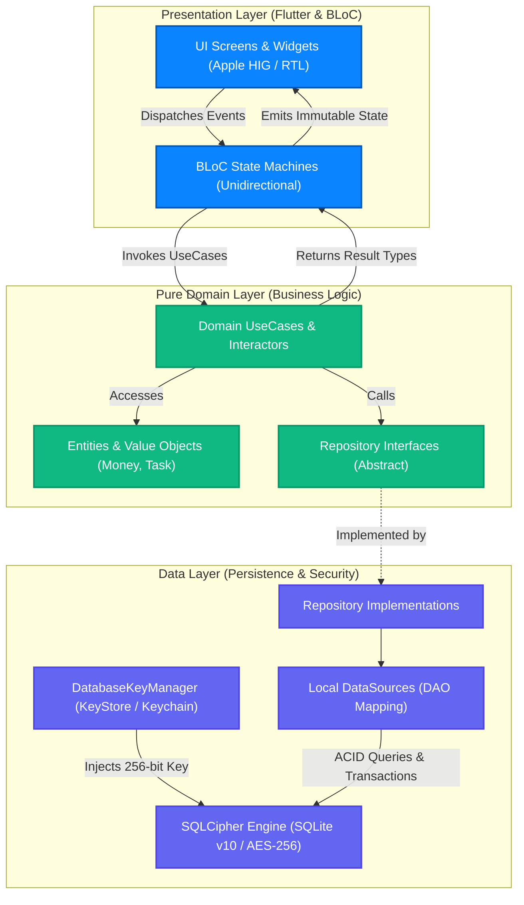
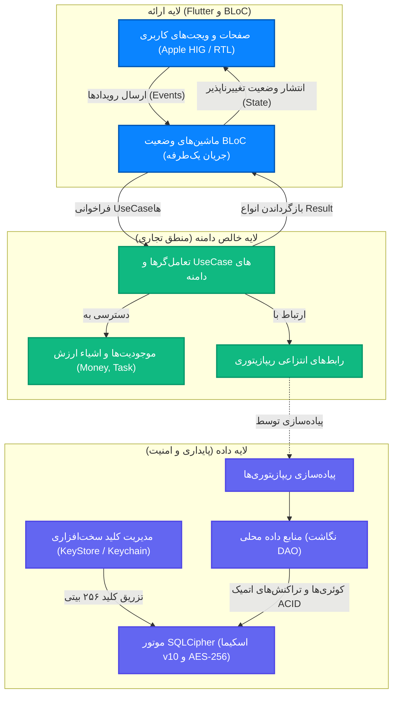

<div align="center">

# TaskFlow (زندگی‌ساز)
### Enterprise Offline-First Productivity Engine

[](https://flutter.dev)
[](https://dart.dev)
[](https://blog.cleancoder.com/uncle-bob/2012/08/13/the-clean-architecture.html)
[](https://bloclibrary.dev)
[](https://www.zetetic.net/sqlcipher/)
[](https://developer.android.com/training/articles/keystore)

<p align="center">
  <a href="#-english-documentation"><b>🇬🇧 English Documentation</b></a> • 
  <a href="#-مستندات-جامع-معماری-فارسی"><b>🇮🇷 مستندات جامع معماری (فارسی)</b></a>
</p>

---

</div>

## 🇬🇧 English Documentation

### 1. Executive Summary & Core Philosophies

**TaskFlow (زندگی‌ساز)** is an enterprise-grade, mission-critical productivity and time-allocation platform engineered for deterministic execution across mobile, desktop, and web environments. Architected from inception on uncompromising engineering standards, TaskFlow eradicates cloud-latency dependencies by operating on an ACID-compliant local relational state backed by SQLite Schema Version 10 and hardened with **AES-256 SQLCipher Encryption at Rest**.

#### Core Architectural Pillars
- **Zero-Debt Architecture:** Every feature adheres strictly to Clean Architecture boundaries. Temporary hacks, loose typings, and unverified workarounds are systematically forbidden.
- **Offline-First Resilience:** 100% of user capabilities—task scheduling, Pomodoro deep work, multi-line financial ledgers, and gamification—execute locally with zero network latency.
- **Strict Type Safety:** Exhaustive compile-time type verification across all layers. Domain entities, value objects, and Result monads prevent runtime exceptions.
- **Single Responsibility Principle (SRP):** High cohesion and loose coupling enforced across presentation widgets, business interactors, and persistence adapters.

---

### 2. Clean Architecture Data Flow



---

### 3. Technology Stack Matrix

| Domain / Layer | Technology | Version | Architectural Purpose & Rationale |
| :--- | :--- | :--- | :--- |
| **Client Platform** | Flutter SDK (Dart) | `>=3.4.0 <4.0.0` | Cross-platform AOT compilation guaranteeing 60/120 FPS jank-free rendering. |
| **System Architecture** | Pure Clean Architecture | Enterprise Spec | Strict decoupled separation into Domain, Data, and Presentation layers. Zero framework leakage into domain. |
| **State Management** | BLoC (`flutter_bloc`) | `^8.1.6` | Event-driven reactive unidirectional data flow. Enforces predictable state transitions and full testability. |
| **Dependency Injection** | GetIt | `^8.0.0` | High-speed Service Locator managing thread-safe Singleton and Factory lifecycles across boundaries. |
| **Encrypted Persistence** | SQLCipher (`sqflite_sqlcipher`) | `^3.1.3` | AES-256 hardware-backed encrypted relational storage utilizing Schema Version 10. |
| **Hardware KeyStore** | Secure Storage | `^9.2.2` | Cryptographic hardware-backed key derivation via Android KeyStore & iOS Keychain. |
| **Identity Management** | Cryptographic UUID | `^4.5.0` | Universal UUID v4 primary keys ensuring collision-free offline record generation for distributed cloud synchronization. |
| **Financial Engine** | `Money` Value Object | Custom Domain | Integer minor-unit arithmetic (Rials). Strict eradication of IEEE-754 floating-point rounding hazards. |
| **Design System & RTL** | Apple HIG + Vazirmatn | Native Tokens | RTL-native pitch-dark visual tokens (`#090B10`), dynamic progress indicators, and Shamsi Jalali formatters. |
| **Local Notifications** | Flutter Local Notifications | `^17.2.2` | Timezone-aware local background alert scheduling decoupled from remote push dependencies. |

---

### 4. Repository Directory Architecture

```text
TaskFlow/
├── .github/                         # Continuous Integration & Delivery workflows
│   └── workflows/
│       └── release.yml              # Automated release pipeline (APK, AAB, Web, GitHub Release)
├── android/                         # Native Android platform configuration & Gradle scripts
├── assets/                          # Local asset bundle (brand logo, vector icons)
│   └── sounds/                      # Pre-cached WAV/MP3 auditory feedback buffers
├── ios/                             # Native iOS configuration, entitlements & Podfile
├── lib/                             # Core Application Source Code (Clean Architecture)
│   ├── main.dart                    # Application bootstrap, MultiBlocProvider & entry point
│   ├── core/                        # Cross-cutting enterprise infrastructure
│   │   ├── concurrency/             # Parallel bootstrapping & background Isolate workers
│   │   ├── di/                      # Dependency Injection container (injection_container.dart)
│   │   ├── error/                   # Failure contracts & strongly typed Exception hierarchy
│   │   ├── notifications/           # Timezone-aware local notification manager
│   │   ├── observability/           # Global BlocObserver for state audit trails & telemetry
│   │   ├── performance/             # Frame-rate optimization & repaint boundary hooks
│   │   ├── result/                  # Functional programming Monad Result<Success, Failure>
│   │   ├── security/                # Hardware key derivation (database_key_manager.dart)
│   │   ├── services/                # Backup, sound, haptic, and platform sync services
│   │   ├── sync/                    # Background sync abstraction & pending sync queue
│   │   ├── theme/                   # Pitch-dark visual tokens, dynamic layouts & RTL typography
│   │   ├── utils/                   # Shamsi Jalali formatters & Persian numeral localization
│   │   └── widgets/                 # Reusable atomic UI components (BouncingTap, Transitions)
│   └── features/                    # Feature Modules (Clean Architecture isolated)
│       ├── analytics/               # Visual heatmaps, daily expenditure ratios & summaries
│       ├── dashboard/               # Today timeline, priority grouping & signature layout
│       ├── gamification/            # XP progression, streak freeze economy & level tiers
│       ├── navigation/              # Main navigation shell & floating action navigation bar
│       ├── notifications/           # Persistent notification center & inbox models
│       ├── onboarding/              # First-launch interactive feature walkthrough
│       ├── settings/                # Preferences, vacation blur switch & technical inspect view
│       ├── splash/                  # Zero-flicker startup splash sequence
│       └── tasks/                   # Core task execution, subtasks, pomodoro & financial ledger
├── test/                            # Comprehensive Automated Test Suites (Unit, BLoC, Widget)
├── .gitignore                       # Sanitized Git ignore rules blocking binary & symbol leaks
├── analysis_options.yaml            # Strict Linter configurations & static analysis constraints
└── pubspec.yaml                     # Application manifest declaring dependencies & assets
```

---

### 5. Architectural Patterns & Security Hardening

#### Offline-First BLoC State Management
The presentation layer communicates with the business domain strictly through reactive unidirectional event pipelines. UI widgets dispatch immutable events to BLoCs; BLoCs interact with UseCases and emit immutable states. No database driver or SQL query is ever accessed directly from the UI layer.

#### Cryptographic Security & Hardware Key Derivation
- **AES-256 Encryption at Rest:** The SQLite database (`task_flow_v1.db`) is encrypted using SQLCipher with military-grade AES-256 encryption.
- **Hardware-Backed Key Derivation (`DatabaseKeyManager`):** The 256-bit encryption key is generated using `Random.secure()` (32 bytes of cryptographically secure entropy) and stored inside Android KeyStore (`encryptedSharedPreferences: true`) and iOS Keychain (`KeychainAccessibility.first_unlock`).
- **Distributed Primary Keys (UUID v4):** All entities utilize cryptographically generated UUID v4 identifiers (`TEXT PRIMARY KEY`), eliminating integer ID collisions and laying the foundation for conflict-free multi-client synchronization.
- **Relational Integrity:** Foreign keys are strictly enforced at runtime (`PRAGMA foreign_keys = ON`), ensuring atomic cascading operations (`ON DELETE CASCADE` for subtasks and expenses, `ON DELETE SET NULL` for focus sessions).
- **Exact Financial Precision:** Financial transactions are stored and calculated strictly using integer minor units (Rials) encapsulated inside the immutable `Money` Value Object, avoiding IEEE-754 floating-point rounding hazards.

---

### 6. Automated CI/CD Pipeline

The repository integrates an automated enterprise GitHub Actions release pipeline (`.github/workflows/release.yml`) triggered on semantic version tags (`v*.*.*`):

```yaml
name: Enterprise Release Pipeline

on:
  push:
    tags:
      - 'v*.*.*'

permissions:
  contents: write

jobs:
  quality-gate:
    name: Strict Quality Gate & Verification
    runs-on: ubuntu-latest
    steps:
      - name: Checkout Codebase
        uses: actions/checkout@v4

      - name: Setup Java Development Kit (JDK 17)
        uses: actions/setup-java@v4
        with:
          distribution: 'zulu'
          java-version: '17'

      - name: Setup Flutter Toolchain
        uses: subosito/flutter-action@v2
        with:
          flutter-version: '3.24.x'
          channel: 'stable'
          cache: true

      - name: Install Project Dependencies
        run: flutter pub get

      - name: Run Static Code Analysis (Zero Tolerance)
        run: flutter analyze --no-fatal-infos

      - name: Run Automated Test Suites
        run: flutter test --coverage

  build-and-release:
    name: Build Production Artifacts & Release
    needs: quality-gate
    runs-on: ubuntu-latest
    steps:
      - name: Checkout Codebase
        uses: actions/checkout@v4

      - name: Setup Java Development Kit (JDK 17)
        uses: actions/setup-java@v4
        with:
          distribution: 'zulu'
          java-version: '17'

      - name: Setup Flutter Toolchain
        uses: subosito/flutter-action@v2
        with:
          flutter-version: '3.24.x'
          channel: 'stable'
          cache: true

      - name: Install Project Dependencies
        run: flutter pub get

      - name: Compile Release Android APK
        run: flutter build apk --release

      - name: Compile Release Android App Bundle (AAB)
        run: flutter build appbundle --release

      - name: Compile Release Web Artifacts
        run: flutter build web --release

      - name: Package Web Build as ZIP
        run: |
          cd build/web
          zip -r ../../build/taskflow-web-release.zip .
          cd ../..

      - name: Publish GitHub Release with Artifacts
        uses: softprops/action-gh-release@v2
        with:
          name: TaskFlow Release ${{ github.ref_name }}
          draft: false
          prerelease: false
          generate_release_notes: true
          files: |
            build/app/outputs/flutter-apk/app-release.apk
            build/app/outputs/bundle/release/app-release.aab
            build/taskflow-web-release.zip
        env:
          GITHUB_TOKEN: ${{ secrets.GITHUB_TOKEN }}
```

---

### 7. Local Development Quick Start

#### Prerequisites
- **Flutter SDK:** `>= 3.4.0` (Stable channel)
- **Dart SDK:** `>= 3.4.0 < 4.0.0`
- **Toolchains:** Android Studio (SDK 34+) / Xcode (15+) / Windows C++ Build Tools (CMake)

```bash
# 1. Clone the secure repository
git clone https://github.com/<your-organization>/TaskFlow.git
cd TaskFlow

# 2. Fetch dependencies
flutter pub get

# 3. Verify static analysis (Zero tolerance for warnings)
flutter analyze --no-fatal-infos

# 4. Execute test suites
flutter test

# 5. Launch application in Debug mode
flutter run
```

---

### 8. Technical Authority & Authors

**TaskFlow Core Architecture Team**  
- **Lead System Architect & DevOps Engineer:** Mahdi Mohebi Nia  
- **Product Ownership:** Commercial Product Owner

---

<div dir="rtl">

## 🇮🇷 مستندات جامع معماری (فارسی)

### ۱. چکیده اجرایی و فلسفه مهندسی سیستم

**تسک‌فلو (زندگی‌ساز)** یک پلتفرم پیشرفته، سازمانی و ماموریت‌محور در حوزه مدیریت زمان، انضباط فردی و مدیریت مالی است که برای پردازش بلادرنگ و بدون نقص در پلتفرم‌های موبایل، دسکتاپ و وب مهندسی شده است. این سامانه با هدف دستیابی به بالاترین سطح کیفیت نرم‌افزاری و حذف کامل تاخیر شبکه، بر پایه‌ ۴ اصل مهندسی غیرقابل‌مذاکره بنا شده و وضعیت داده‌ها را در یک پایگاه داده رابطه‌ای سازگار با استاندارد ACID (نسخه اسکیما ۱۰ SQLite) با **رمزنگاری سطح نظامی AES-256 SQLCipher در حالت سکون** نگهداری می‌کند.

#### اصول بنیادین معماری
- **معماری بدون بدهی فنی (Zero-Debt Architecture):** تمامی قابلیت‌ها منطبق بر مرزهای مشخص Clean Architecture توسعه یافته‌اند. استفاده از راهکارهای موقتی، تایپ‌های سست و میان‌برهای غیرفنی در کل سیستم اکیداً ممنوع است.
- **تاب‌آوری آفلاین‌محور (Offline-First Resilience):** ۱۰۰٪ امکانات کاربر شامل زمان‌بندی تسک‌ها، جلسات تمرکز عمیق پومودورو، دفاتر کل چندخطی مالی و موتور گیمیفیکیشن بدون نیاز به شبکه به شکل محلی اجرا می‌شوند.
- **ایمنی محض در لایه تایپ‌ها (Strict Type Safety):** اعتبارسنجی جامع در زمان کامپایل از طریق موجودیت‌های ایمیوتبل، اشیاء ارزش و ساختار تابعی Result Monad مانع از بروز هرگونه خطای پیش‌بینی‌نشده در زمان اجرا می‌گردد.
- **اصل تک‌مسئولیتی (Single Responsibility Principle):** انسجام بالا و پیوند سست در تمام ویجت‌های لایه ارائه، تعامل‌گرهای منطق تجاری و آداپتورهای ذخیره‌سازی داده رعایت شده است.

---

### ۲. نمودار جریان داده در معماری تمیز (Clean Architecture Data Flow)



---

### ۳. ماتریس فناوری‌های سیستم

| لایه معماری | فناوری انتخابی | نسخه | هدف فنی و دلیل انتخاب |
| :--- | :--- | :--- | :--- |
| **هسته کلاینت** | فریم‌ورک Flutter (Dart) | `>=3.4.0 <4.0.0` | کامپایل بومی AOT جهت ارائه رندرینگ ۶۰ و ۱۲۰ فریم بر ثانیه بدون افت فریم. |
| **الگوی معماری** | معماری تمیز (Clean Architecture) | استاندارد سازمانی | تفکیک کامل به لایه‌های Presentation، Domain و Data بدون نفوذ فریم‌ورک به هسته بیزینس. |
| **مدیریت وضعیت** | الگوی BLoC (`flutter_bloc`) | `^8.1.6` | جریان واکنشی داده‌ها به صورت یک‌طرفه با رفتار کاملاً قطعی و قابلیت تست‌پذیری حداکثری. |
| **تزریق وابستگی** | ابزار GetIt | `^8.0.0` | Service Locator پرسرعت برای مدیریت چرخه حیات سینگلتون‌ها و فکتوری‌ها در مرزهای لایه‌ها. |
| **دیتابیس محلی** | موتور SQLCipher (`sqflite_sqlcipher`)| `^3.1.3` | پایگاه‌داده رابطه‌ای امن با استاندارد ACID و رمزنگاری سخت‌افزاری AES-256 بر پایه اسکیما نسخه ۱۰. |
| **کلیدهای سخت‌افزاری**| حافظه امن (`flutter_secure_storage`)| `^9.2.2` | ذخیره‌سازی کلید رمزنگاری در بستر سخت‌افزاری Android KeyStore و iOS Keychain. |
| **مدیریت هویت** | شناسه یکتای UUID v4 | `^4.5.0` | تولید شناسه‌های تصادفی توزیع‌شده بدون تداخل جهت همگام‌سازی ابری آینده کلاینت‌ها. |
| **محاسبات مالی** | شیء ارزش `Money` | کلاس دامین اختصاصی | محاسبات مالی با واحدهای صحیح (ریال) و حذف کامل خطای محاسباتی ممیز شناور (IEEE-754). |
| **رابط کاربری و فونت**| دستورالعمل Apple HIG + وزیرمتن | طراحی Pitch-Dark | تم تیره اختصاصی (`#090B10`)، تایپوگرافی بومی راست‌به‌چپ (RTL) و فرمت‌کننده‌های تقویم جلالی. |
| **سامانه اعلانات** | اعلانات محلی فلاتر | `^17.2.2` | زمان‌بندی دقیق هشدارهای پس‌زمینه با آگاهی از تایم‌زون بدون نیاز به سرور پوش نوتیفیکیشن. |

---

### ۴. ساختار درختی دایرکتوری‌های مخزن پروژه

```text
TaskFlow/
├── .github/                         # گردش‌های کاری یکپارچه‌سازی و استقرار مداوم (CI/CD)
│   └── workflows/
│       └── release.yml              # پایپ‌لاین خودکار انتشار نسخه (APK، AAB، Web و GitHub Release)
├── android/                         # پیکربندی بومی سیستم‌عامل اندروید، قواعد ProGuard و اسکریپت‌های Gradle
├── assets/                          # بسته دارایی‌های بصری محلی (لوگوی برند و آیکون‌های وکتور بومی‌سازی‌شده)
│   └── sounds/                      # بافرهای صوتی از پیش کش‌شده WAV/MP3 با تاخیر صفر (فیدبک صوتی)
├── ios/                             # پیکربندی بومی iOS، مجوزها (Entitlements) و مشخصات CocoaPods
├── lib/                             # کدهای مبدا هسته اپلیکیشن (مبتنی بر Clean Architecture)
│   ├── main.dart                    # نقطه شروع اپلیکیشن، راه‌اندازی اولیه و ارکستراسیون MultiBlocProvider
│   ├── core/                        # زیرساخت‌های مهندسی سازمانی مشترک در سطح سامانه
│   │   ├── concurrency/             # راه‌اندازی موازی و ورکر‌های ایزوله در پس‌زمینه (Isolates)
│   │   ├── di/                      # کانتینر تزریق وابستگی سازمانی (injection_container.dart)
│   │   ├── error/                   # قراردادهای شکست (Failures) و سلسله‌مراتب کلاس‌های استثنا (Exceptions)
│   │   ├── notifications/           # مدیریت محلی اعلانات با آگاهی از موقعیت زمانی و تایم‌زون
│   │   ├── observability/           # دیده‌بان سراسری BLoC جهت ره‌گیری و ثبت لاگ‌های چرخه حیات استیت
│   │   ├── performance/             # موتور رندرینگ بهینه و مرزبندی بازترسیم ویجت‌ها (RepaintBoundary)
│   │   ├── result/                  # ساختار برنامه‌نویسی تابعی موناد Result<Success, Failure>
│   │   ├── security/                # مشتق‌سازی کلید سخت‌افزاری (database_key_manager.dart)
│   │   ├── services/                # سرویس‌های پشتیبان‌گیری محلی، بافرهای صدا، هپتیک و همگام‌سازی ویجت
│   │   ├── sync/                    # انتزاع همگام‌سازی آفلاین‌محور و صف عملیات‌های در انتظار
│   │   ├── theme/                   # توکن‌های بصری تم تاریک مطلق، لایه‌بندی پویا و تایپوگرافی راست‌به‌چپ
│   │   ├── utils/                   # فرمت‌کننده‌های تاریخ شمسی جلالی و تبدیل‌کننده‌های اعداد به فارسی
│   │   └── widgets/                 # کامپوننت‌های اتمیک بازکاربردپذیر (BouncingTap و DualLayoutTransition)
│   └── features/                    # حوزه‌های ماژولار فیچرها (تفکیک‌شده در سه لایه دامین، دیتا و ارائه)
│       ├── analytics/               # نقشه‌های حرارتی تکمیل تسک‌ها، نمودارهای تعادل ریالی و شاخص‌های کلیدی
│       ├── dashboard/               # خط زمان برنامه امروز، نشانگر هوشمند تسک‌های معوقه و لایه‌بندی اختصاصی
│       ├── gamification/            # موتور ارتقای سطح، سپرهای محافظ استمرار و دفتر کل امتیازات XP
│       ├── navigation/              # نوار ناوبری شناور پایینی و ارکستراسیون پوسته اصلی صفحات
│       ├── notifications/           # صندوق ورودی اعلانات دائمی و تاریخچه هشدارهای سیستمی
│       ├── onboarding/              # فرآیند تعاملی معرفی قابلیت‌ها در نخستین راه‌اندازی برنامه
│       ├── settings/                # تنظیمات کاربر، سوئیچ تارکننده حالت استراحت و بازرس تنظیمات فنی
│       ├── splash/                  # صفحه اسپلش بومی با لودینگ سریع و بدون پرش فریم
│       └── tasks/                   # هسته مدیریت تسک‌ها، ساب‌تسک‌ها، تایمر پومودورو و دفتر ثبت هزینه‌ها
├── test/                            # سوئیت جامع آزمون‌های خودکار (تست‌های واحد، تست‌های BLoC و قراردادهای ویجت)
├── .gitignore                       # قوانین پالایش‌شده گیت جهت مسدودسازی نشت فایل‌های باینری و دیباگ
├── analysis_options.yaml            # تنظیمات قوانین سخت‌گیرانه تحلیل استاتیک و قواعد لینتر دارت
└── pubspec.yaml                     # مانیفست اصلی پروژه شامل اعلان وابستگی‌ها، فونت‌ها و دارایی‌ها
```

---

### ۵. الگوهای معماری و امنیت داده‌ها

#### مدیریت وضعیت واکنشی آفلاین‌محور (BLoC Engine)
لایه ارائه (UI) منحصراً از طریق پایپ‌لاین‌های رویدادمحور و واکنش‌گرا با لایه منطق تجاری ارتباط برقرار می‌کند. ویجت‌ها رویدادهای تغییرناپذیر (Events) را صادر می‌کنند؛ BLoCها با فراخوانی UseCaseها، وضعیت جدید (State) را به شکل تغییرناپذیر ساطع می‌نمایند. هیچ درایور یا کوئری مستقیم پایگاه داده در لایه UI وجود ندارد.

#### استحکامات رمزنگاری و حفاظت اطلاعات (Cryptographic Hardening)
- **رمزنگاری در حالت سکون با AES-256:** فایل محلی دیتابیس (`task_flow_v1.db`) به وسیله موتور SQLCipher با رمزنگاری نظامی AES-256 محافظت شده و دسترسی فیزیکی، استخراج حافظه یا ابزارهای روت/جیلبریک قادر به خواندن داده‌ها نیستند.
- **مدیریت کلید در سطح سخت‌افزار (`DatabaseKeyManager`):** کلید ۲۵۶ بیتی به شکل کاملاً رمزنگاری‌شده با ۳۲ بایت انتروپی تصادفی امن (`Random.secure()`) تولید و در Keystore سخت‌افزاری اندروید (`encryptedSharedPreferences`) و Keychain سیستم‌عامل iOS ذخیره می‌شود.
- **شناسه‌های اصلی توزیع‌شده (UUID v4):** تمام جداول برنامه از شناسه‌های متنی تصادفی UUID v4 به عنوان کلید اصلی (`TEXT PRIMARY KEY`) استفاده می‌کنند تا در فرآیند همگام‌سازی ابری آینده هیچ‌گونه تداخل کلیدی رخ ندهد.
- **یکپارچگی رابطه‌ای دیتابیس:** فعال‌سازی اجباری `PRAGMA foreign_keys = ON` در زمان اتصال، اجرای اتمیک تراکنش‌ها و حذف آبشاری ساب‌تسک‌ها و هزینه‌ها (`ON DELETE CASCADE`) و لغو ارجاع جلسات تمرکز (`ON DELETE SET NULL`) را تضمین می‌کند.
- **محاسبات مالی بدون ممیز شناور:** مبالغ به صورت عدد صحیح ریال ذخیره شده و در شیء ارزش `Money` کپسوله شده‌اند تا خطاهای رایج محاسبات ممیز شناور (IEEE-754) به صفر برسد.

---

### ۶. خط لوله خودکار انتشار (CI/CD Pipeline)

پروژه مجهز به یک پایپ‌لاین خودکار در بستر GitHub Actions (`.github/workflows/release.yml`) است که با تگ‌گذاری نگارش‌ها (`v*.*.*`) فعال می‌شود:

```yaml
name: Enterprise Release Pipeline

on:
  push:
    tags:
      - 'v*.*.*'

permissions:
  contents: write

jobs:
  quality-gate:
    name: Strict Quality Gate & Verification
    runs-on: ubuntu-latest
    steps:
      - name: Checkout Codebase
        uses: actions/checkout@v4

      - name: Setup Java Development Kit (JDK 17)
        uses: actions/setup-java@v4
        with:
          distribution: 'zulu'
          java-version: '17'

      - name: Setup Flutter Toolchain
        uses: subosito/flutter-action@v2
        with:
          flutter-version: '3.24.x'
          channel: 'stable'
          cache: true

      - name: Install Project Dependencies
        run: flutter pub get

      - name: Run Static Code Analysis (Zero Tolerance)
        run: flutter analyze --no-fatal-infos

      - name: Run Automated Test Suites
        run: flutter test --coverage

  build-and-release:
    name: Build Production Artifacts & Release
    needs: quality-gate
    runs-on: ubuntu-latest
    steps:
      - name: Checkout Codebase
        uses: actions/checkout@v4

      - name: Setup Java Development Kit (JDK 17)
        uses: actions/setup-java@v4
        with:
          distribution: 'zulu'
          java-version: '17'

      - name: Setup Flutter Toolchain
        uses: subosito/flutter-action@v2
        with:
          flutter-version: '3.24.x'
          channel: 'stable'
          cache: true

      - name: Install Project Dependencies
        run: flutter pub get

      - name: Compile Release Android APK
        run: flutter build apk --release

      - name: Compile Release Android App Bundle (AAB)
        run: flutter build appbundle --release

      - name: Compile Release Web Artifacts
        run: flutter build web --release

      - name: Package Web Build as ZIP
        run: |
          cd build/web
          zip -r ../../build/taskflow-web-release.zip .
          cd ../..

      - name: Publish GitHub Release with Artifacts
        uses: softprops/action-gh-release@v2
        with:
          name: TaskFlow Release ${{ github.ref_name }}
          draft: false
          prerelease: false
          generate_release_notes: true
          files: |
            build/app/outputs/flutter-apk/app-release.apk
            build/app/outputs/bundle/release/app-release.aab
            build/taskflow-web-release.zip
        env:
          GITHUB_TOKEN: ${{ secrets.GITHUB_TOKEN }}
```

---

### ۷. راهنمای راه‌اندازی سریع در محیط توسعه

#### پیش‌نیازهای محیط اجرا
- **کیت توسعه نرم‌افزار Flutter:** نسخه `>= 3.4.0` (کانال Stable)
- **کیت توسعه نرم‌افزار Dart:** نسخه `>= 3.4.0 < 4.0.0`
- **ابزارهای کامپایل محلی:** Android Studio (SDK 34+) / Xcode (15+) / Windows C++ Build Tools (CMake)

```bash
# ۱. کلون کردن مخزن امن پروژه
git clone https://github.com/<your-organization>/TaskFlow.git
cd TaskFlow

# ۲. دریافت وابستگی‌ها
flutter pub get

# ۳. اعتبارسنجی تحلیل استاتیک (تحمل صفر در برابر اخطارها)
flutter analyze --no-fatal-infos

# ۴. اجرای سوئیت آزمون‌های خودکار
flutter test

# ۵. اجرای برنامه در حالت دیباگ
flutter run
```

---

### ۸. حاکمیت فنی و مالکیت پروژه

**تیم راهبری فنی TaskFlow**  
- **معمار ارشد سیستم و مهندس DevOps:** مهدی محبی‌نیا  
- **مالکیت محصول:** Product Owner تجاری

*تسک‌فلو نرم‌افزاری انحصاری و طراحی‌شده بر پایه‌ بالاترین استانداردهای مهندسی نرم‌افزار است. هرگونه تغییر در لایه‌های بنیادین بدون تاییدیه فنی اکیداً ممنوع می‌باشد.*

</div>
